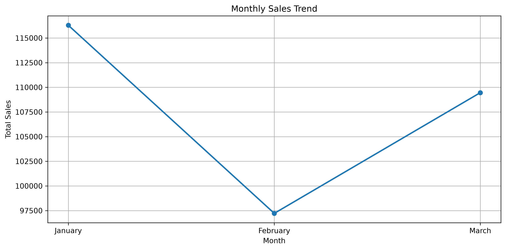
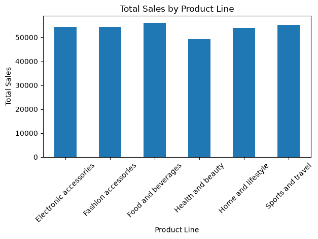
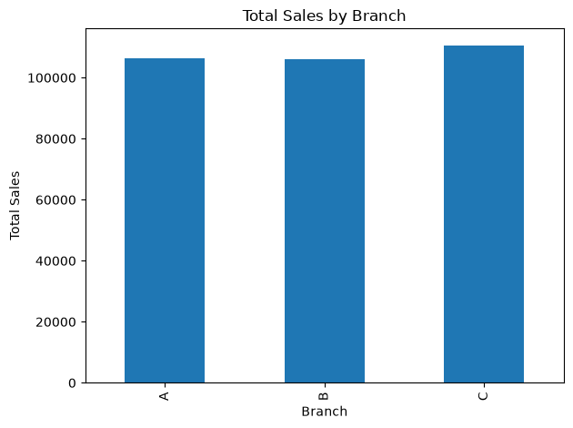
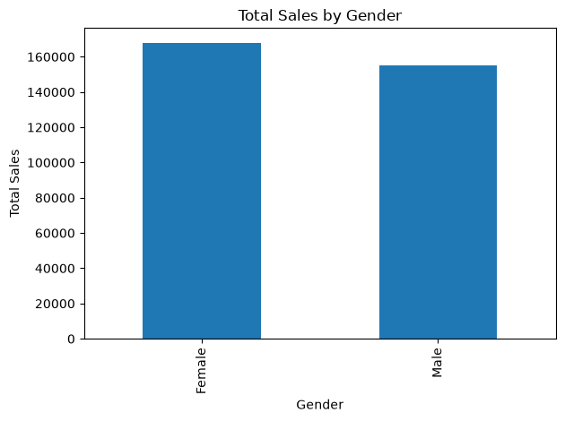
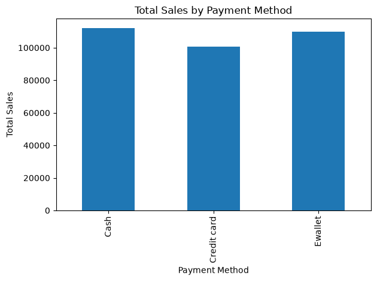
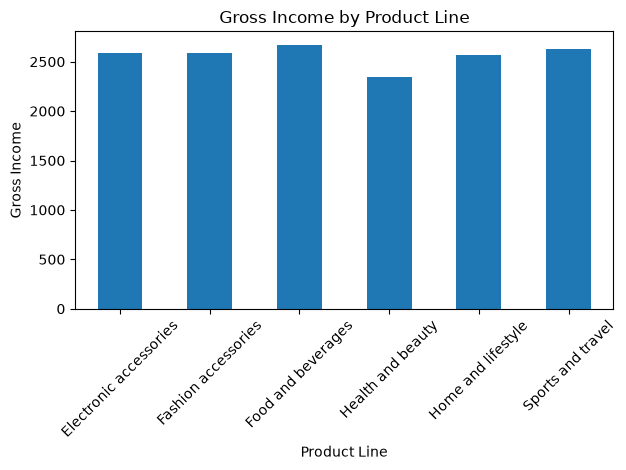
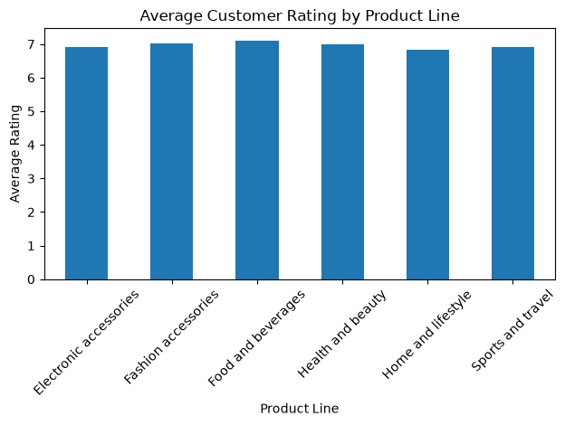
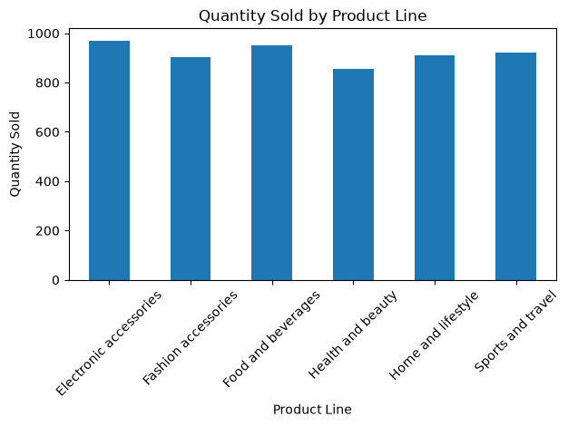

# Supermarket Sales Analysis & Data Visualization

## Project Overview

This project analyzes supermarket sales data to identify sales trends, customer behavior, product performance, and business insights using Python, Pandas, Matplotlib, and MySQL.

The project also includes a dedicated **Data Visualization** task to transform analyzed data into clear and meaningful visualizations.

## Objectives

* Analyze overall supermarket sales performance
* Identify top-performing product lines
* Compare sales across branches and cities
* Analyze customer types and payment methods
* Analyze sales trends by month and day
* Identify gross income patterns
* Create clear and meaningful data visualizations
* Present data-driven insights using charts and graphs
* Generate business insights using SQL and Python

## Tools & Technologies

* Python
* Pandas
* Matplotlib
* MySQL
* Jupyter Notebook
* VS Code
* GitHub

## Project Structure

```text
supermarket-sales-analysis/

├── data/
│   └── supermarket_sales.csv
│
├── notebooks/
│   ├── supermarket_analysis.ipynb
│   └── task3_data_visualization.ipynb
│
├── sql/
│   └── analysis.sql
│
├── images/
│   ├── monthly_sales_trend.png
│   ├── sales_by_product_line.png
│   ├── sales_by_branch.png
│   ├── sales_by_gender.png
│   ├── sales_by_payment.png
│   ├── gross_income_by_product.png
│   ├── average_rating_by_product.png
│   ├── quantity_by_product.png
│   ├── sales_vs_quantity.png
│   ├── avg_unit_price_by_product_line.png
│   ├── transaction_sales_distribution.png
│   ├── sales_by_day_of_week.png
│   ├── payment_vs_customer_type.png
│   ├── correlation_heatmap.png
│   ├── average_sales_by_customer_type.png
│   ├── average_sales_by_gender.png
│   ├── quantity_distribution.png
│   └── sales_vs_gross_income.png
│
└── README.md
```

## Analysis Performed

### Python Analysis

* Total sales analysis
* Sales by product line
* Sales by branch
* Sales by gender
* Sales by customer type
* Sales by payment method
* Monthly sales analysis
* Gross income analysis
* Customer rating analysis
* Quantity sold analysis

### SQL Analysis

* Total sales
* Sales by product line and branch
* Sales by gender and customer type
* Sales by payment method
* Monthly and daily sales
* Top 5 product lines
* Top 10 transactions
* Highest gross income transaction
* Sales and gross income by branch

## Data Visualization

The Data Visualization task focuses on presenting supermarket sales data through clear and meaningful charts using Python and Matplotlib.

### Visualizations Created

1. Sales vs Quantity
2. Average Unit Price by Product Line
3. Distribution of Transaction Sales
4. Total Sales by Day of the Week
5. Sales by Payment Method and Customer Type
6. Correlation Between Numerical Variables
7. Average Sales by Customer Type
8. Average Sales by Gender
9. Distribution of Quantity per Transaction
10. Sales vs Gross Income

## Key Insights

* Branch C generated the highest total sales.
* Food and beverages generated the highest total sales among product lines.
* Female customers generated higher total sales than male customers.
* Member customers generated slightly higher total sales than normal customers.
* Cash was the highest-used payment method by total sales.
* January recorded the highest monthly sales.
* Electronic accessories had the highest quantity sold.
* Food and beverages generated the highest gross income.

## Visualizations

### Monthly Sales Trend



### Sales by Product Line



### Sales by Branch



### Sales by Gender



### Sales by Payment Method



### Gross Income by Product Line



### Average Customer Rating by Product Line



### Quantity Sold by Product Line



### Sales vs Quantity


### Average Unit Price by Product Line


### Distribution of Transaction Sales


### Total Sales by Day of the Week


### Sales by Payment Method and Customer Type


### Correlation Heatmap


### Average Sales by Customer Type


### Average Sales by Gender


### Distribution of Quantity per Transaction


### Sales vs Gross Income


## How to Run the Project

### 1. Clone the Repository

```bash
git clone <your-github-repository-url>
```

### 2. Open the Project

Open the `supermarket-sales-analysis` folder in VS Code.

### 3. Install Required Libraries

```bash
pip install pandas matplotlib numpy
```

### 4. Run the Python Analysis

Open the notebooks inside the `notebooks/` folder and run the cells.

* `supermarket_analysis.ipynb` — Python sales analysis
* `task3_data_visualization.ipynb` — Data Visualization

### 5. Run the SQL Analysis

Open `sql/analysis.sql` in MySQL Workbench and execute the queries using the `supermarket_sales` database.

## Project Results

The analysis identified important patterns in supermarket sales, including:

* Monthly sales trends
* Product line performance
* Branch-wise sales performance
* Customer purchasing patterns
* Payment method usage
* Gross income performance
* Quantity sold by product line
* Top-performing transactions
* Relationships between numerical variables
* Sales patterns across customer segments

## Author

**Salmon Raju**

CSE (AI & ML) Student | Aspiring Data Analyst
